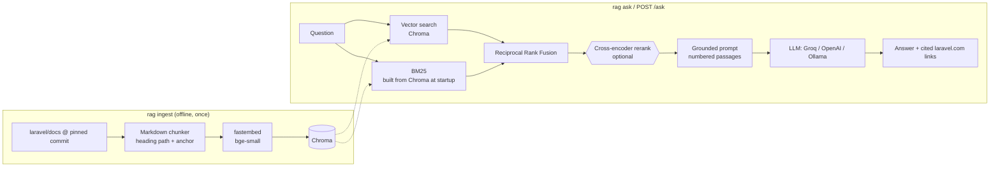

# Ask the Laravel docs

A small retrieval-augmented generation (RAG) app that answers questions about the official
[Laravel 13.x documentation](https://github.com/laravel/docs/tree/13.x) and cites the exact
section on laravel.com for every claim. It is written in plain Python with no LangChain or
LlamaIndex, so every step (chunking, hybrid search, fusion, reranking, prompting) is visible.

- **Hybrid retrieval:** local embeddings (fastembed, `BAAI/bge-small-en-v1.5`) in **Chroma**,
  plus **BM25** keyword search, fused with **Reciprocal Rank Fusion**. An optional
  **cross-encoder reranker** can reorder the results.
- **Grounded answers:** the LLM (Groq by default; OpenAI or Ollama work through the same
  client) answers only from the retrieved passages, cites them as `[1]`, `[2]`, and declines
  when the docs don't cover the question.
- **Interfaces:** a CLI (`ingest`, `ask`, `eval`), a FastAPI service (`POST /ask`,
  `GET /health`) and a one-file web page at `/`.
- **Measured:** an eval harness reports hit@1, hit@5 and MRR@10 for each retrieval mode.

## Architecture



## Quickstart

### With uv

```bash
cp .env.example .env              # then set GROQ_API_KEY (free at console.groq.com)
uv sync
uv run rag ingest                 # downloads docs, ~4.5k chunks, ~5 min on a laptop CPU
uv run rag ask "How do I run code after all jobs in a batch finish?"
uv run rag serve                  # http://127.0.0.1:8000 (web page) and /docs (OpenAPI)
uv run pytest                     # offline unit + API tests
```

### With Docker

```bash
cp .env.example .env              # set GROQ_API_KEY
docker compose build              # models are baked into the image
docker compose run --rm app ingest   # builds the index into the `rag-data` volume
docker compose up                 # API on http://localhost:8000 (APP_PORT=8080 to change)

curl -s localhost:8000/ask -H 'Content-Type: application/json' \
  -d '{"question": "How do I hide the password attribute in JSON?"}'
```

Run `ingest` before `up`, or restart the app after a re-ingest: the API loads the index once,
on its first request.

## Example

```text
$ uv run rag ask "How do I dispatch a batch of jobs and run something when they all finish?"
To dispatch a batch and execute code after all jobs in the batch have finished, use the
`Bus::batch` method and attach a `then` callback. [...]

    $batch = Bus::batch([
        new ProcessCsvChunk(1),
        new ProcessCsvChunk(2),
    ])->then(function (Batch $batch) {
        // runs after every job in the batch succeeds
    })->dispatch();

(See the documentation on dispatching batches and the `then` callback [1][5].)

Sources:
 *[1] Queues > Job Batching > Dispatching Batches
      https://laravel.com/docs/13.x/queues#dispatching-batches
  [2] Queues > Job Batching > Dispatching Batches > Batch Connection and Queue
      https://laravel.com/docs/13.x/queues#batch-connection-queue
  ...
 *[5] Queues > Job Batching > Chains and Batches
      https://laravel.com/docs/13.x/queues#chains-and-batches
```

`*` marks the sources the answer actually cites. For a question the docs don't cover
("How do I configure Django REST framework throttling?") the reply is
`I couldn't find this in the Laravel 13.x documentation.` and no sources are listed.

## Evaluation

`rag eval --file <questions.jsonl> [--answers]` runs each in-scope question through all four
retrieval modes. A retrieved chunk counts as a hit when its file matches the gold file and the
gold heading appears anywhere in the chunk's heading path. Results are written to
`eval/results/<name>.md`.

**Held-out set** (`eval/questions.jsonl`: 44 in-scope + 6 out-of-scope questions written
independently and never used for tuning; full report in
[`eval/results/questions.md`](eval/results/questions.md)):

| Mode | hit@1 | hit@5 | MRR@10 |
|---|---|---|---|
| vector | 0.61 | **0.89** | 0.73 |
| bm25 | 0.61 | 0.80 | 0.69 |
| hybrid (RRF, default) | **0.70** | 0.86 | **0.77** |
| hybrid + rerank | 0.59 | 0.86 | 0.72 |

Generation (`--answers`, hybrid, `openai/gpt-oss-120b` on Groq): 6/6 out-of-scope questions
declined; 40/44 in-scope questions answered, all with citations.

Honest reading: hybrid puts the right section first more often (hit@1 0.70 vs 0.61), but vector
alone finds it in the top 5 slightly more often, and the MRR gain (+0.04 on 44 questions) is
within noise. Reranking with the default MiniLM cross-encoder hurt on both sets. A full
`--answers` run takes about 10 minutes because of LLM calls.

**Dev set** (`eval/dev_questions.jsonl`, 30 in-scope + 5 out-of-scope; retrieval was tuned on
these, so the numbers are optimistic; small, so ±1 question moves a metric by about 0.03):

| Mode | hit@1 | hit@5 | MRR@10 |
|---|---|---|---|
| vector | 0.70 | 0.97 | 0.79 |
| bm25 | 0.50 | 0.90 | 0.68 |
| hybrid (RRF) | **0.73** | 0.93 | **0.81** |
| hybrid + rerank | 0.63 | 0.93 | 0.75 |

Generation (`--answers`, hybrid mode, `openai/gpt-oss-120b` on Groq): 5/5 out-of-scope
questions correctly declined, 26/30 in-scope questions answered with at least one citation.
The other 4 were declined. In three of them retrieval had missed the right section. In the
fourth (scheduling a command daily at 1am) the section was ranked 5th, but the model was too
cautious to use it.


## Design decisions and trade-offs

- **Why hybrid search?** Embeddings capture meaning ("stop a job being queued twice") but
  blur exact identifiers. BM25 catches `ShouldBeUnique`, `queue:work` and `--tries`, which
  matter a lot in framework docs. RRF fuses the two lists using ranks only, so the scores never
  need normalising, and the code is about 10 lines (`fusion.py`).
- **Why is reranking off by default?** A cross-encoder usually helps, and the code supports one
  (`USE_RERANK=true`, or `"mode": "hybrid_rerank"` per request). On the dev set, though,
  `ms-marco-MiniLM-L-6-v2` lowered hit@1. That model was trained on web search queries, not on
  code-heavy docs. `bge-reranker-base` (tried manually) only roughly matched plain hybrid, cost about 2 s per
  query and would add about 1 GB to the image. So the eval decided the default, and the
  reranker stays available as a switch.
- **Why Chroma?** It is a real vector database with on-disk persistence, it runs embedded with
  no extra service, and it fits about 4.5k chunks easily. It is also the single store for chunk
  text and metadata: the BM25 index is rebuilt from it at startup, so the two can't drift apart.
  For millions of vectors or multiple writers I would move to pgvector or Qdrant.
- **Why no LangChain?** The whole pipeline is about 1,300 lines including docstrings. Writing it directly keeps every
  step debuggable and explainable, and it avoids abstraction churn. The OpenAI SDK is the only
  "framework", and it is used purely as an HTTP client for any OpenAI-compatible endpoint.
- **Chunking follows the docs' structure.** It splits at headings, keeps the full heading path
  (prepended to the text before embedding) and the `<a name>` anchor for deep links. Fenced code
  blocks are never split, and long sections are packed to about 1500 characters with a small
  overlap.
- **Local embeddings (fastembed/ONNX).** There is no API key and no PyTorch, the cost per query
  is zero, and the models are baked into the Docker image.
- **The docs are pinned to a commit** (`config.DOCS_COMMIT`), so the index and the eval numbers
  can be reproduced.

## Limitations

- English only, Laravel 13.x only. There is no conversation memory: each question stands alone.
- Ingest re-embeds everything (about 5 minutes on CPU). Incremental updates are not
  implemented.
- A few code samples are longer than the embedding model's 512-token window, so only their
  start is embedded. They are also truncated to 4000 characters in the prompt.
- The model sometimes declines a question that is in scope when retrieval misses the right
  section. That is the safe failure, but it is still a miss.
- Groq's free tier is rate-limited. The client retries with backoff, so `eval --answers` is
  slow.
- The LLM default is `openai/gpt-oss-120b`, because `llama-3.3-70b-versatile` is no longer
  served on Groq. Set `LLM_MODEL` to change it.

## Project layout

```
src/laravel_docs_rag/   config, docs_source, chunking, embeddings, vector_store, bm25,
                        fusion, rerank, retrieval, generation, citations, pipeline,
                        ingest, evaluation, api, cli, static/index.html
tests/                  chunking, RRF, citations, eval metrics, API (fake LLM)
eval/                   dev_questions.jsonl, results/
docs/WALKTHROUGH.md     module-by-module tour of the code
```

See [docs/WALKTHROUGH.md](docs/WALKTHROUGH.md) for a guided read of the code.

## License

MIT, see [LICENSE](LICENSE).
